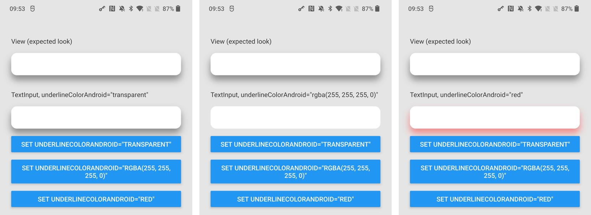

# Reproducer: Android TextInput `boxShadow` is hidden by `underlineColorAndroid`

Created from the [React Native reproducer template](https://github.com/react-native-community/reproducer-react-native). React Native 0.88.1, New Architecture.

On Android, the color filter that `underlineColorAndroid` applies to a `TextInput` background also applies to its `boxShadow`. `TextInput` defaults `underlineColorAndroid` to `transparent`, so the shadow disappears whenever the filter is applied after the shadow drawables exist. iOS is not affected.

The only code change to the template is [`ReproducerApp/App.tsx`](ReproducerApp/App.tsx).

## Steps

1. `cd ReproducerApp && yarn install && yarn android`
2. On launch, the `TextInput` shows its shadow like the `View` above it.
3. Press `Set underlineColorAndroid="rgba(255, 255, 255, 0)"`. The prop changes from one fully transparent color to another, and the shadow disappears.
4. Press `Set underlineColorAndroid="red"`. The shadow turns red.
5. Press `Set underlineColorAndroid="transparent"`. The shadow disappears again.

Expected: the `TextInput` shadow looks like the `View` shadow for every `underlineColorAndroid` value.

